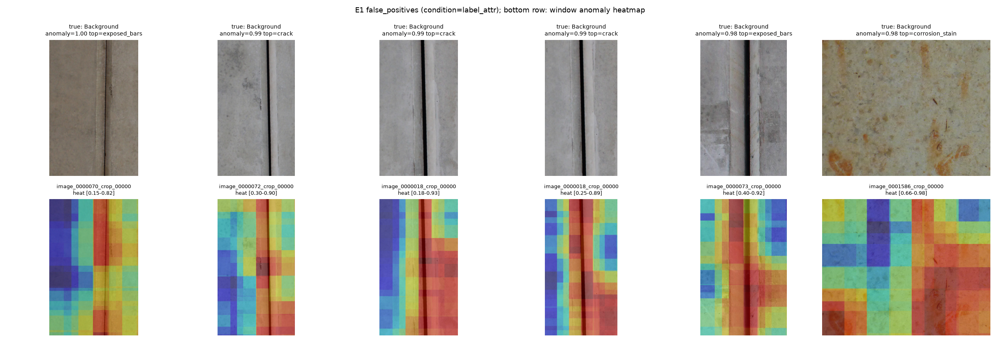

# 点検要領の言い換えによる視覚言語モデルの損傷認識：予備実験

研究計画書「点検要領の言い換えによる視覚言語モデルの損傷認識 ―画像アノテーションに依存しない専門知識の注入―」の予備実験（第3章）のコードと結果です。

> **English summary.** Training-free experiments testing whether visual descriptions derived from the Japanese bridge inspection manual (MLIT, July 2024) improve CLIP's zero-shot recognition of concrete damage. Seven prompt conditions with matched prompt counts (including a random-word control) are compared on CODEBRIM (632 test images) with paired bootstrap CIs. Descriptions improve damage-type discrimination beyond the random-word control, but not binary anomaly detection or localisation; effects differ strongly across damage types; literal translations of manual terms hurt.

## 主な結果

OpenAI CLIP（QuickGELU版）を学習なしで使用。AUROC、正常側は基本記述、各条件のプロンプト数は1クラス10件。

| 条件 | T1 異常検出（ViT-L/14） | T2 種別識別（ViT-L/14） | T2 種別識別（ViT-B/16） |
|---|---|---|---|
| label（クラス名） | 0.815 | 0.705 | 0.685 |
| term_literal（要領用語の逐語訳） | 0.780 | 0.642 | 0.663 |
| attr（視覚記述のみ） | 0.760 | 0.661 | 0.691 |
| **label_attr（クラス名＋視覚記述）** | 0.825 | **0.737** | **0.728** |
| llm（LLM言い換えのみ） | 0.774 | 0.669 | 0.680 |
| label_llm（クラス名＋LLM言い換え） | 0.839 | 0.732 | 0.723 |
| waffle（クラス名＋無作為語） | **0.841** | 0.692 | 0.657 |

1. 損傷種別の識別では記述の内容が効く：label_attr は label より T2 で +0.032（95%CI [0.021, 0.042]）、同数の無作為語の waffle より +0.044（[0.035, 0.054]）。
2. 二値の異常検出・局在化では損傷側の記述は効かない。誤検出の上位は目地（下図）。正常側に紛らわしい正常状態の記述を加えると T1 が向上した。
3. 効果は損傷種別で大きく異なる：鉄筋露出は記述のみで 0.671→0.896、剥離は全条件で 0.56 以下、錆汁は記述で低下。
4. 要領用語の逐語訳は性能を下げる（T2 −0.063）。CC12M での出現頻度は efflorescence 0.9、rust juice 0（100万件あたり）。
5. 程度表現は要領に基づく記述のみが両モデルで一貫して機能（ひびわれ長さとの順位相関 ρ=0.435 / 0.460）。



全結果：`results/vitl14_openai/summary.md`、`results/vitb16_openai/summary.md`

## 再現手順

```bash
python3 -m venv ~/venvs/clip && source ~/venvs/clip/bin/activate
pip install torch torchvision && pip install -r requirements.txt pyarrow
python selftest.py
bash download_data.sh          # CODEBRIM のダウンロードと DeepCrack
python extract_codebrim.py     # CODEBRIM の展開（下記参照）
python check_setup.py          # READY を確認
bash run_all.sh                # 2 モデル × E1–E3
python get_cc12m.py && python e0_caption_freq.py --captions downloads/cc12m.tsv --col 1   # 任意：E0
```

Zenodo の `CODEBRIM_classification_dataset.zip` は中央ディレクトリのファイル位置が信頼できず、`unzip` では val/test を展開できない（md5 は一致）。`extract_codebrim.py` はローカルファイルヘッダを走査して直接展開し、CRC を検証する（1,250 ファイル全件で一致）。

`prompts.yaml` の視覚記述（attr）は国土交通省『橋梁定期点検要領』（令和6年7月）の付録-3 と損傷事例写真から作成し、全件に出典頁を付記している。

## 注意事項

- CODEBRIM には同一原画像からの切り出しが複数含まれ、信頼区間は楽観的である可能性がある。
- 初回実行ではモデル名 `ViT-L-14` を指定したため QuickGELU が一致していなかった。本リポジトリの結果はすべて `*-quickgelu` で再実行したもの。
- 実験コードの作成と `prompts.yaml` の `llm` 欄の生成には Anthropic の Claude を使用した。`attr` 欄は点検要領に基づき出典頁とともに作成した。

## データセット

データセットは含まない。CODEBRIM（Mundt et al., CVPR 2019、非商用）、DeepCrack（Liu et al., Neurocomputing 2019、非商用）、CC12M（Changpinyo et al., CVPR 2021）。`results/*/figures/` の図には CODEBRIM と DeepCrack の画像の一部が含まれる。コードは MIT License。
